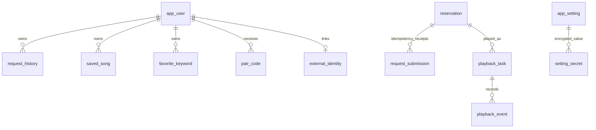

# SQLite → MySQL 迁移设计与执行状态

本文最初记录迁移前设计。Phase 16 已创建 MySQL Compose 服务和 13 张表，Fastify 核心预约/队列/设置路由已配置为 MySQL 数据访问；因此原始“尚未执行/没有切换应用流量”文字已过时。完整现状及未迁移边界见 [Phase 16 进度](REFACTOR_PROGRESS.md#phase-16-mysql-核心切换与视频主机连接) 与 [兼容矩阵](LEGACY_COMPATIBILITY.md)。

MySQL 不能据此视为全项目唯一数据库：Legacy PHP 的个人页、收藏、配对、Bingo、评论、通知、未命中歌曲和优先级等模块仍有 SQLite 读写代码；YukaLister SQLite 是独立搜索索引。完整迁移尚未验收。当前正常 Compose 下自动播放仍关闭。

## 当前实际数据所有权

- 主队列库是 `legacy/php/runtime/queue/request.db`。PHP 容器看到 `/var/www/html/runtime/queue/request.db`，Fastify 看到 `/run/legacy-db/request.db`；两者实际共享同一个文件。宿主机目录中存在 SQLite `-wal` 与 `-shm` 旁文件。
- 运行库当前包含 `requesttable`、`request_submission`、`playback_task`、`playback_event`，以及 `mypage_user`、`mypage_history`、`mypage_later`、`mypage_favorite_song`、`mypage_favorite_keyword`、`mypage_pair_code`、`mypage_google_link`。
- `requesttable` 保存预约、队列顺序、Legacy 播放标志、保密位、媒体标识和播放控制字段。`request_submission` 是 Phase 8 持久幂等收据。`playback_task` 与 `playback_event` 是 Phase 10 正式任务和追加历史。
- 配置不是全在 SQLite：当前可编辑设置及管理认证等还在 `legacy/php/config.ini`。设置 GET 投影由 Node 实现，设置 PUT 仍由 PHP 写 INI。
- 不是所有 PHP 数据都在主库。源码另有 `mypage_class` 用户数据表，以及 Bingo、评论、通知、未命中歌曲、搜索优先级、元数据修正等辅助 SQLite 库/文件。YukaLister 的 `List.sqlite3` 是搜索索引；Everything 是外部索引服务。这些不能仅靠迁移主 `request.db` 自动进入 MySQL。

## 目标关系

目标使用 MySQL 8.4 LTS + InnoDB + `utf8mb4`。主要实体如下；实际列映射与枚举值必须由可重复导入及 Legacy 行为对照测试锁定。

| MySQL 实体 | 来源/用途 | 关键设计 |
| --- | --- | --- |
| `reservation` | `requesttable` | 保留原预约字段、整数 ID、`reqorder`、`nowplaying` 兼容投影、`playtimes`、secret/kind/控制项及 Lister 元数据；不对 `reqorder` 加唯一约束，以保留历史异常数据的表达能力。读取排序仍显式按 `reqorder, id`。媒体路径来自服务端搜索/请求适配，不开放任意路径写入。 |
| `request_submission` | Phase 8 | 哈希收据唯一键、输入哈希、owner、reservation 引用、操作/结果/时间；使用 InnoDB 事务与 reservation 更新原子提交。重复相同键返回既有结果，不重复历史或通知。 |
| `playback_task` | Phase 10 | UUID 任务、reservation 可空引用及原 ID 快照、状态、Agent、lease、命令序号、实际播放态和时间。MySQL 没有 SQLite partial unique index，改用生成列 `active_request_id` 与 `active_slot`，仅活动状态产生非 NULL 值并加唯一索引。 |
| `playback_event` | Phase 10 | `task_id` 外键、唯一 `event_key`、事件类型、Agent、时间、脱敏 JSON；只追加。停止/跳过/失败/EOF 的投影与 task 事件同事务提交。 |
| `app_user` | `mypage_user` | 用户 UUID、展示名、图标标识、创建时间；不把当前 IP/UA 当作持久账号主键。 |
| `request_history` | `mypage_history` | 用户、路径/曲目/类型快照、请求时间；这是请求历史，不与播放事件混淆。 |
| `saved_song` | `mypage_later` + `mypage_favorite_song` | 用户与规范化曲目键的复合唯一键，类别区分稍后/收藏；保留原显示字段。 |
| `favorite_keyword` | `mypage_favorite_keyword` | 用户、关键词、搜索类型/参数和创建时间。 |
| `pair_code` | `mypage_pair_code` | 哈希后的短期 code、用户、到期时间；不继续明文持久化可重放验证码。 |
| `external_identity` | `mypage_google_link` | 用户与外部 subject 唯一关联；access/refresh token 加密 envelope 存储，密钥由容器 Secret 提供，不存数据库。 |
| `app_setting` / `setting_secret` | `config.ini`、辅助 INI/JSON | 有版本号的类型化非秘密设置与并发更新；敏感值独立 AES-GCM envelope、密钥外置并带 key version。管理密码迁移为专用 password hash，不能把 INI 原文复制到普通设置表。 |
| `legacy_aux_*` 后续模块 | 通知、未命中、Bingo、评论、修正等 | 按功能确认是否仍被使用、数据语义和写入者后单独映射；不把索引缓存或临时文件盲目塞入主 schema。 |

设置由 `setting_revision`/事务版本防止覆盖并发修改。播放任务、预约与历史在单 MySQL 事务中完成；通知仍是提交后副作用，保留“已提交但通知未确认”的结果语义。会话与 Agent 凭据不作为明文或 Basic 密码写入业务表。

## 唯一写入者与兼容切换

不能在 React/Fastify 切到 MySQL、同时让 Legacy PHP 继续写 SQLite；这会产生双主数据和不可解的队列顺序分歧。目标是 Fastify 为新客户端的唯一业务 API，MySQL 为迁移后唯一主数据源；Legacy 页面对已迁移功能只能使用经过认证的 Node 兼容入口，未迁移 PHP 功能暂时保留 SQLite 时必须明确标为独立旧域，不能伪称已迁完。

迁移顺序建议：

1. 新建 MySQL DDL、版本化迁移器、只读 Navicat 账号和健康检查；在合成库执行约束、事务、排序、幂等并发、回滚和重启测试。
2. 增加 TypeScript MySQL repository，先并行做 SQLite/MySQL 行为 oracle，不双写。将 Node 已拥有的队列、幂等、预约、播放任务、事件、设置逐项切换。
3. PHP 写入入口逐功能关闭或转到经过 Node 权限校验的固定兼容 API；补 Legacy 页面 E2E，禁止无认证的 PHP → Node 管理调用和递归。
4. 审计/迁移用户和辅助库。YukaLister/Everything 索引先保留各自 Owner；若要把搜索索引也迁入 MySQL，必须先确认搜索引擎支持与索引重建语义，不能破坏现有搜索。
5. 正式切换前停所有写者和 WAL anchor，使用一致性 SQLite 备份导入 MySQL；校验行数、ID/顺序/状态、收据唯一性、历史、任务事件、设置 revision 与关键哈希。保留原库为只读回滚来源。
6. 切换只发生一次：先将正式 Compose 指向 MySQL，再按只读检查和真实 E2E 验证；回滚需停写并确定新库没有未导出的新写入，禁止直接覆盖新库或同时恢复旧库写入。

## Compose 与 Navicat 方案

部署形态目标为 `yukari-mysql` 单独容器 + 持久命名 volume，服务只加入 Compose 私有网络。Navicat 访问默认只绑定 `127.0.0.1`，使用 `localhost`、专用端口和**只读账号**，不暴露到局域网；Root 密码/应用密码由 `.local` 忽略文件或 Docker Secrets 注入，不写进 Git/Compose 明文。正式端口/账号/凭据在容器实现时生成并单独交付。

迁移前没有可供 Navicat 连接的 MySQL 服务。本段为历史设计判断；Phase 16 后 Navicat 开发连接位于 `127.0.0.1:3307`，账号和密码位置见 `docs/PHASE16-MYSQL-CUTOVER.md`（密码只保存在本机受保护文件）。SQLite 当前仍是文件型旧数据/搜索索引，不是 MySQL endpoint；不得把 SQLite 文件复制/改名伪装成 MySQL 数据库。
